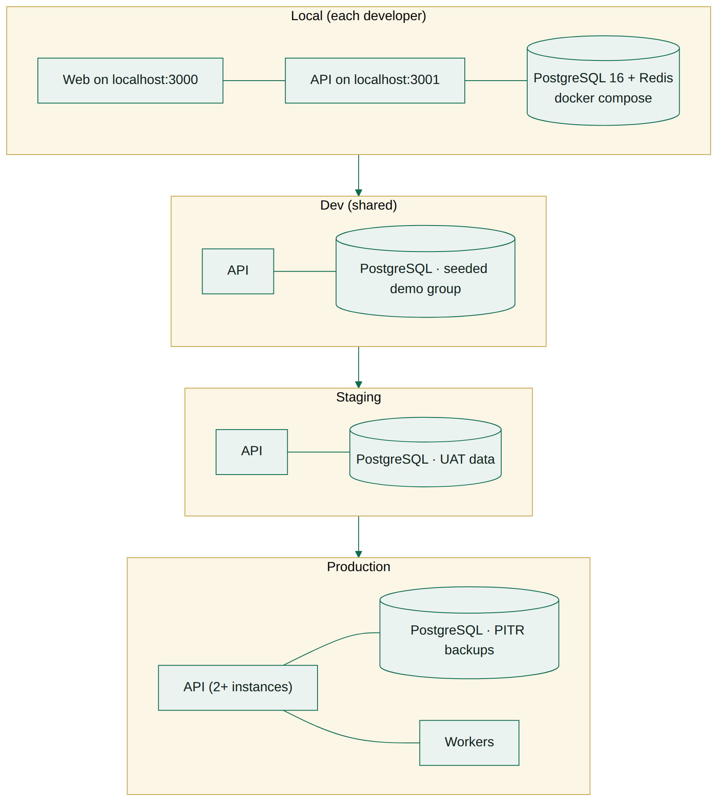
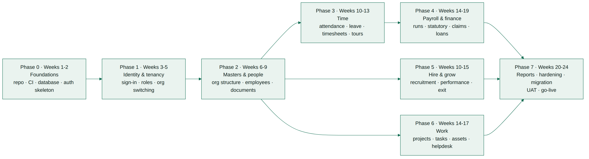
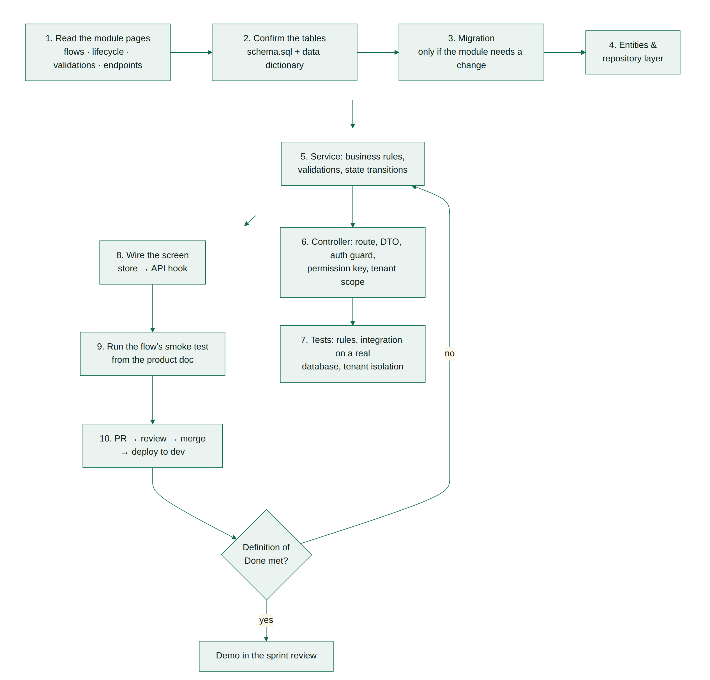
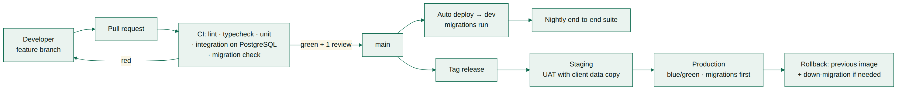

# Seereon HRMS — Development Flow

_How the team builds it · v1.1 · 23 September 2026 · Seereon_

## 1. What this document is

This is the build path for Seereon HRMS — the order of work, the steps every developer repeats for each module, and the checks a piece of work must pass before it is called done. It assumes the web frontend (seereon-hrms-web v6.0, converted from the v5.1 prototype) is the functional specification and that the Django + FastAPI backend is built behind it, module by module, without changing what the screens do.

| Item                | Detail                                                                                                                                                                                 |
| ------------------- | -------------------------------------------------------------------------------------------------------------------------------------------------------------------------------------- |
| Product             | Seereon HRMS — HRMS by Seereon                                                                                                                                                         |
| Starting point      | Seereon HRMS web frontend v6.0 (Next.js, JavaScript/JSX — repository seereon-hrms-web): 96 screens, 5 portals, 57 business flows, running on built-in demo data                        |
| Target              | Same product on a real backend: Python (Django + FastAPI) + PostgreSQL 16 + background workers                                                                                         |
| Size of the job     | 339 tables · 541 endpoints · 11 functional modules · 247 business rules                                                                                                                |
| Suggested team      | 1 tech lead, 2–3 backend developers, 1 frontend developer, 1 QA, part-time DevOps                                                                                                      |
| Suggested duration  | 24 weeks in 12 two-week sprints (team of 5, see chapter 4)                                                                                                                             |
| Companion documents | Product Documentation (what to build) · API Documentation + openapi.json v1.1 (the contract) · Database Design v1.0 (the schema) · seereon-hrms-web README and docs/API_INTEGRATION.md |

### 1.1 The three rules

1. **The documents are the specification.** If a rule is not in the Product Documentation, it is not a requirement — raise it instead of inventing it.
2. **The database is the authority.** Every rule that can be a constraint is already a constraint. Services validate first, but nothing depends on the client behaving.
3. **One module at a time, finished end to end.** A module is done when its screens run on the API with no browser storage left behind — not when the endpoints exist.

## 2. Team and responsibilities

| Role                                 | Owns                                                                                       | Typical week                                                                   |
| ------------------------------------ | ------------------------------------------------------------------------------------------ | ------------------------------------------------------------------------------ |
| Tech lead                            | Architecture, schema changes, code review, release                                         | Reviews every PR, unblocks, owns the sprint goal and the release               |
| Backend developer (2–3, Python)      | Modules end to end: Django models, services, DRF / FastAPI endpoints, tests                | Two to four module slices per sprint, from migration to wired screen           |
| Frontend developer (React / Next.js) | Switching screens from demo data to the API in seereon-hrms-web, auth wiring, error states | Follows one sprint behind the backend on the same modules                      |
| QA                                   | Test cases from the flows, regression suite, UAT support                                   | Writes cases from chapter 5 of the Product Documentation before the code lands |
| DevOps (part-time)                   | Environments, CI/CD, backups, monitoring, secrets                                          | Pipeline and infrastructure; on call for deploys                               |

Keep module ownership stable: whoever builds payroll keeps payroll through UAT. Rotating people across a statutory module mid-build is the fastest way to lose the rules.

## 3. Environments and tooling


_Figure 3.1 — Environments_

| Environment | Purpose                                  | Data                                           | Deploys                     |
| ----------- | ---------------------------------------- | ---------------------------------------------- | --------------------------- |
| Local       | Day-to-day development                   | Seed data loaded from the migration scripts    | Developer, on demand        |
| Dev         | Shared integration, demos                | Demo group (Seereon + 3 entities) reset weekly | Automatic on merge to main  |
| Staging     | UAT, performance and migration rehearsal | Copy of client UAT data                        | On release tag              |
| Production  | Live clients                             | Real data, PITR backups                        | Manual approval, blue/green |

### 3.1 Toolchain

| Concern       | Choice                                                                           | Why                                                                                              |
| ------------- | -------------------------------------------------------------------------------- | ------------------------------------------------------------------------------------------------ |
| Database      | PostgreSQL 16                                                                    | Row-level security for tenancy, exact numerics for payroll, JSONB for configurable forms         |
| Web app       | Next.js 16 + React 19, JavaScript (JSX) — repository seereon-hrms-web            | Already built: every screen, route, role guard and a generated API client                        |
| Core API      | Python 3.12 · Django 5 + Django REST Framework                                   | Admin, ORM, migrations, permissions and serializers for the transactional modules                |
| Service APIs  | FastAPI (same database, same JWT)                                                | High-throughput or async work: sign-in/tokens, file uploads, device ingest, report downloads     |
| Data access   | Django ORM + Django migrations; SQLAlchemy 2 in FastAPI                          | Initial models generated from schema.sql (inspectdb); RLS and triggers kept as RunSQL migrations |
| Validation    | DRF serializers / Pydantic v2 on the server; zod in the web app                  | Both follow the rules in chapter 7 of the Product Documentation and the OpenAPI contract         |
| Jobs          | Celery + Redis (beat for schedules)                                              | Payroll, statutory files, exports, SLA timers, notifications                                     |
| Files         | S3-compatible storage with pre-signed URLs                                       | Documents, payslips, proofs, attachments                                                         |
| Tests         | pytest + pytest-django + Testcontainers (PostgreSQL); Playwright in the web repo | Unit rules, integration on a real PostgreSQL, end-to-end on the real UI                          |
| CI/CD         | GitHub Actions                                                                   | Lint, typecheck, test, migration check, deploy                                                   |
| Observability | Structured logs + OpenTelemetry + Sentry                                         | Trace id on every request, error alerting                                                        |

### 3.2 Local setup — first day

```
# backend (Python)
git clone <backend-repo> && cd seereon-hrms-api
cp .env.example .env
docker compose up -d                      # PostgreSQL 16 + Redis + MinIO
python -m venv .venv && source .venv/bin/activate
pip install -r requirements/dev.txt
python manage.py migrate                  # schema from the v1.0 design
python manage.py loaddata demo_group      # demo group, entities, users from the prototype
python manage.py runserver 8000           # Django REST API   → http://localhost:8000/api/v1
uvicorn services.main:app --port 8001     # FastAPI services  (behind the same /api/v1 gateway)
pytest                                    # unit + integration

# web (Next.js)
git clone <web-repo> && cd seereon-hrms-web
cp .env.example .env.local                # VITE_API_BASE_URL=http://localhost:8000/api/v1
npm install && npm run dev                # http://localhost:3000

```

> A developer should be able to sign in as superadmin@seereon.co.in on their own machine by the end of day one. If that takes longer, fix the setup before writing features.

## 4. The build path


_Figure 4.1 — Phases. Phases 5 and 6 run in parallel with 3 and 4 once people and masters are live._

| Phase   | Name                                   | When                   | Needs      | Scope                                                                                                                                                                                                                                                                           | Done when                                                                                                                                   |
| ------- | -------------------------------------- | ---------------------- | ---------- | ------------------------------------------------------------------------------------------------------------------------------------------------------------------------------------------------------------------------------------------------------------------------------- | ------------------------------------------------------------------------------------------------------------------------------------------- |
| Phase 0 | Foundations                            | Weeks 1–2              | —          | Repository, CI, database from schema.sql, seed script, application skeleton, health checks, error format (RFC 7807), logging, file upload service.                                                                                                                              | A developer can run everything locally; migrations and seed run clean in CI; one trivial endpoint is deployed to dev.                       |
| Phase 1 | Identity, tenancy & access             | Weeks 3–5              | Phase 0    | Sign-in for the three portals, JWT + refresh, password policy and lock-out, forgot/reset, permissions endpoint, roles and action keys, org switching for Super Admin, users & logins, delegation, temporary access, approval engine, announcements, audit trail.                | Every role signs in and sees exactly the screens from the permission matrix; a second entity's data is invisible; audit rows are written.   |
| Phase 2 | Masters, organisation & people         | Weeks 6–9              | Phase 1    | Company groups, entities, branches, departments, designations, master data (CRUD sections), documents and policies, employee records with job, compensation, bank and statutory details, manager and HR-partner mapping, movements (promotion, transfer, warning, termination). | An employee can be created from the record form with every validation, appears in the directory and can sign in.                            |
| Phase 3 | Time, attendance & leave               | Weeks 10–13            | Phase 2    | Shifts, patterns, work configuration, punches and the attendance register, regularisation, locks, leave policies and applications with approval chains, comp-off, timesheets, tours and travel, daily-wage muster.                                                              | A month can be marked, approved and locked; leave balances move correctly; timesheets and tours run through their approval chains.          |
| Phase 4 | Payroll, statutory & finance           | Weeks 14–19            | Phase 3    | Salary structures and pay grades, payroll run with maker–checker, compliance checks, PF/ESI/PT/LWF, TDS and declarations, proof of investment, Form 16, payslips, reimbursement claims, loans and advances, expenditure, statutory filings (ECR/ESI/24Q).                       | A full month runs for a demo entity and reconciles line by line against the prototype; filings generate; payslips are visible to employees. |
| Phase 5 | Hire and grow                          | Weeks 10–15 (parallel) | Phase 2    | Job posts, applicants, interviews and scorecards, offers, candidate portal, onboarding and new hires, goals, appraisal cycles, reviews, PIP, training, exit workflow, full-and-final, grievances.                                                                               | Recruit-to-hire and resignation-to-settlement both run end to end on the API.                                                               |
| Phase 6 | Work and service                       | Weeks 14–17 (parallel) | Phase 2    | Projects, tasks and updates with approval, asset master, issuance, returns and condition issues, helpdesk tickets with SLA, service catalogue.                                                                                                                                  | Asset issue → acknowledge → return → recovery works; tickets escalate on SLA breach.                                                        |
| Phase 7 | Reports, hardening, migration, go-live | Weeks 20–24            | Phases 3–6 | Report and export engine, dashboards, notification templates and e-mail, performance tuning, penetration test fixes, data migration from the prototype, UAT, runbooks, go-live.                                                                                                 | UAT signed off; migration rehearsed twice on staging; rollback tested; production live with monitoring.                                     |

### 4.1 Size of each module

Use these counts for sprint planning: a backend developer delivers roughly 12–18 endpoints per two-week sprint including tests, less for payroll and statutory work, more for master-data CRUD.

| Module                            | Tables | Columns | Endpoints | Phase |
| --------------------------------- | ------ | ------- | --------- | ----- |
| Platform & Tenancy                | 27     | 384     | 52        | 1–2   |
| Identity, Access & Administration | 37     | 546     | 51        | 1     |
| Employees & Organisation          | 30     | 456     | 40        | 2     |
| Recruitment & Onboarding          | 20     | 350     | 31        | 5     |
| Masters, Policies & Documents     | 18     | 291     | 58        | 2     |
| Time, Attendance, Leave & Travel  | 30     | 519     | 61        | 3     |
| Payroll, Statutory, Tax & Finance | 55     | 851     | 77        | 4     |
| Performance, Goals & Learning     | 59     | 863     | 52        | 5     |
| Exit, Grievance & HR Policy       | 26     | 447     | 46        | 5     |
| Projects, Tasks & Assets          | 20     | 411     | 35        | 6     |
| Helpdesk & Reporting              | 11     | 179     | 26        | 6     |
| Platform Infrastructure           | 6      | 89      | 0         | 0     |

## 5. How to build one module

Every module follows the same ten steps. A module slice is one entity (for example _leave applications_), not a whole chapter — keep slices to two or three days.


_Figure 5.1 — The loop each slice goes through_

### 5.1 The ten steps in detail

1. **Read the module pages.** Product Documentation: the flows (chapter 5), the record lifecycle (chapter 6) and the validations (chapter 7) for this entity. API Documentation: every endpoint for the entity, with its permission key and errors. Fifteen minutes here saves a day of rework.
2. **Confirm the tables.** Find the entity in the Database Design workbook: columns, constraints, foreign keys. The tables already exist — do not create new ones because a column name is unfamiliar.
3. **Write a migration only if the module genuinely needs a change.** Never edit an applied migration; add a new numbered file. Schema changes are reviewed by the tech lead.
4. **Models.** Django models for the tables (generated once from the schema with inspectdb, then owned by Django migrations), with the tenant column on every query through a tenant-aware manager. No raw SQL in views.
5. **Service layer.** Port the rules from the prototype module named in the API document's _Source_ line: validations, the state machine, approval chain, side effects. Wrap multi-table commands in one transaction.
6. **Endpoint.** Route exactly as documented (DRF viewset or FastAPI router), request validated by the serializer / Pydantic model, authentication, permission key (DRF permission class or FastAPI dependency), row scope (self / team / department / entity / group), idempotency for money commands, ETag for decisions.
7. **Tests.** Unit tests for each validation and transition; an integration test per endpoint against a real PostgreSQL; one test proving a second entity cannot see or touch the rows; one negative test per error in the API document.
8. **Wire the screen.** In seereon-hrms-web, switch the module from demo data to the API as described in its docs/API_INTEGRATION.md (the endpoint function already exists in src/services/api), handle loading and error states, and remove the demo store once the module is live.
9. **Run the flow.** Execute the smoke test for this flow from chapter 10 of the Product Documentation, including the rejection path.
10. **Pull request.** Small, one slice, with the checklist below. Merge only when CI is green and one reviewer has approved.

### 5.2 Definition of Ready (before a ticket is picked up)

- The flow, lifecycle and validations for the slice are identified by section number.
- The endpoints are listed with their permission keys.
- The tables and any schema change are agreed with the tech lead.
- Test data exists in the seed, or the ticket says how to create it.
- Acceptance criteria are written as steps a tester can follow.

### 5.3 Definition of Done

- All endpoints in the slice implemented, documented in OpenAPI and returning the documented errors.
- Every validation from chapter 7 enforced server-side, with a test.
- State transitions enforced; illegal transitions return 409.
- Tenant isolation test passing; permission key checked in code, not only in the UI.
- Audit event written for every command; money commands idempotent.
- Screen running on the API with the browser store removed.
- Smoke test for the flow passes on dev; no console errors.
- openapi.json updated (and the web client regenerated with seereon-hrms-api/tools/gen_api_docs.py), migrations applied cleanly on a fresh database, CI green, PR reviewed.

### 5.4 Code review checklist

- Tenant: is `org_id` taken from the token, never from the request body?
- Permission: is the documented action key checked? Can a user act on someone else's record?
- Self-approval: is the actor blocked from approving their own request?
- Transaction: do multi-table writes commit or roll back together?
- Money: `Decimal` / `numeric(14,2)`, never floats; totals recomputed server-side, never trusted from the client.
- Dates: `USE_TZ = True`, business dates in Asia/Kolkata stored as `date`; no naive datetimes, no UTC arithmetic that can slip a day.
- Errors: RFC 7807 shape with the documented code; no stack traces in responses.
- Logs: no PAN, Aadhaar, bank account, salary or password in logs.
- Tests: is there a failing-path test, not only the happy path?
- Dead code: is the replaced store or unused prototype path deleted?

## 6. Ways of working

| Ceremony        | When                                 | Output                                                    |
| --------------- | ------------------------------------ | --------------------------------------------------------- |
| Sprint planning | Monday, start of the sprint, 90 min  | Sprint goal, slices assigned, dependencies flagged        |
| Daily stand-up  | Every morning, 15 min                | Blockers surfaced the same day                            |
| Design check    | Before any schema or contract change | Tech lead's decision recorded in the ticket               |
| Sprint review   | Friday, end of the sprint            | Working demo of each slice against the flow it implements |
| Retrospective   | After the review, 30 min             | One or two process fixes for the next sprint              |

### 6.1 Branching and commits

- `main` is always deployable. Work on short-lived branches: `feat/leave-applications`, `fix/payroll-tds-rounding`.
- Conventional commits: `feat(leave): apply leave endpoint with balance check`.
- Rebase before merge, squash on merge, delete the branch.
- A branch older than three days is a warning sign — split the slice.


_Figure 6.1 — From branch to production_

### 6.2 Ticket template

```
Title:    [Module] Slice — e.g. [Leave] Apply and approve leave
Spec:     Product doc 5.4.1 (flow), 6.6 (lifecycle), 7.4 rules 12–19; API doc 8.3
Tables:   leave_applications, leave_policies, compoff_ledger
Endpoints: POST /leave/applications, GET /leave/applications, POST /leave/applications/{id}/decisions
Acceptance:
  1. Employee applies; overlapping dates rejected with 422
  2. Balance held as pending; manager approves; balance deducted
  3. Employee cannot approve their own application (403)
  4. Second entity cannot see the application
Done: DoD in the development flow document, chapter 5.3
```

## 7. Testing

| Layer                  | What it covers                                                                   | Where it runs                        | Who          |
| ---------------------- | -------------------------------------------------------------------------------- | ------------------------------------ | ------------ |
| Unit                   | Validations, calculations (payroll, TDS, leave balance), state machines          | Every PR                             | Developer    |
| Integration            | Endpoint against a real PostgreSQL with seed data; permissions; tenant isolation | Every PR                             | Developer    |
| Contract               | Responses match openapi.json                                                     | Every PR                             | Developer    |
| End-to-end             | The 57 flows driven through the UI with Playwright                               | Nightly on dev, before every release | QA           |
| Payroll reconciliation | A full month compared line by line against the prototype                         | Each payroll release                 | QA + finance |
| Performance            | 500 concurrent users, payroll for 5,000 employees, report exports                | Before go-live and quarterly         | DevOps       |
| Security               | Authentication, authorisation, tenant leakage, file access, dependency scan      | Before go-live and quarterly         | Tech lead    |

> Write the tenant-isolation test once as a shared helper and call it for every module: sign in as entity A, create a record, sign in as entity B, assert 404 on read, update, delete and list. This one test catches the most dangerous class of bug in a multi-company product.

## 8. Data migration and go-live

1. Freeze the prototype for the pilot client and export the browser data (one JSON per store, from the console).
2. Load reference and master data first: group, entities, branches, departments, designations, masters, policies.
3. Load people: employees, jobs, compensation, bank and statutory details, then user accounts (passwords are re-issued, never migrated).
4. Load transactional history only where it is needed: current-year attendance, leave balances, open claims and loans, payroll runs of the current financial year.
5. Resolve identifiers: the prototype stores business codes; the loader looks each one up and writes the `uuid` foreign key. Anything unresolved goes to an exception list and is fixed before the next rehearsal.
6. Reconcile: employee headcount, leave balances, loan outstanding, year-to-date payroll totals and statutory figures must match the source exactly.
7. Rehearse the whole migration twice on staging and time it; the third run is the live one.
8. Go-live weekend: freeze, migrate, reconcile, smoke test with real users on Saturday, open on Monday with the team on standby.
9. Keep the prototype available read-only for four weeks.

### 8.1 Release and rollback

- Migrations are applied before the new build goes live and must be backward compatible for one release (add columns, then backfill, then drop later).
- Deploy blue/green; keep the previous image ready to switch back within minutes.
- Never roll back a migration that has deleted data — restore from PITR instead. This is why destructive migrations are split across releases.
- Every release has a one-page note: what changed, which migrations ran, what to watch, how to roll back.

## 9. Risks to manage from day one

| Risk                              | Why it hurts                                         | What we do                                                                                |
| --------------------------------- | ---------------------------------------------------- | ----------------------------------------------------------------------------------------- |
| Tenant data leakage               | One client seeing another's payroll ends the product | org_id from the token only, row-level security in the database, isolation test per module |
| Payroll incorrectness             | Statutory penalties and loss of trust                | Reconcile a full month against the prototype; maker–checker; audit every override         |
| Statutory changes (PF/ESI/PT/TDS) | Rules change every budget                            | Rates and slabs in configuration tables, never in code                                    |
| Scope creep during the build      | Phases slip and quality drops                        | Documents are the specification; changes go through the tech lead and the backlog         |
| Time-zone and date slips          | Attendance and payroll off by a day                  | Business dates in Asia/Kolkata, stored as `date`; no UTC arithmetic on business dates     |
| Large exports and reports         | Slow screens, blocked API                            | Reports run as jobs and return a download link                                            |
| Personal data exposure            | DPDP Act obligations                                 | Encrypt PAN/Aadhaar/bank, mask in lists, log access, retention policy                     |

## 10. Where everything is

| Question                             | Document                        | Where                                                                      |
| ------------------------------------ | ------------------------------- | -------------------------------------------------------------------------- |
| What should this screen do?          | Product Documentation           | Chapter 5 — business flows                                                 |
| What statuses can this record have?  | Product Documentation           | Chapter 6 — record lifecycles                                              |
| What must I validate?                | Product Documentation           | Chapter 7 — validations                                                    |
| Who may do this?                     | Product Documentation           | Chapter 3 — roles, screens and action keys                                 |
| What is the endpoint?                | API Documentation               | Endpoint index, then the module chapter                                    |
| What does the response look like?    | openapi.json (v1.1)             | Import into Swagger UI or Postman                                          |
| Which screen calls this endpoint?    | seereon-hrms-web                | src/services/api/endpoints — JSDoc names the file that implements it today |
| How do I switch a screen to the API? | seereon-hrms-web                | docs/API_INTEGRATION.md                                                    |
| What tables and columns?             | Database Design v1.0 + workbook | Chapter 7 and the Columns sheet                                            |
| How do the tables relate?            | Database Design v1.0 + workbook | ER diagrams and the Relationships sheet                                    |
| How do I run it locally?             | This document                   | Chapter 3.2                                                                |
| Is my work finished?                 | This document                   | Chapter 5.3                                                                |

**First week checklist:** environment running locally · sign in as every demo role on the web app (seereon-hrms-web) · read chapters 2, 3 and 4 of the Product Documentation · read chapters 2 and 3 of the Database Design · pick up a Phase 1 slice.
